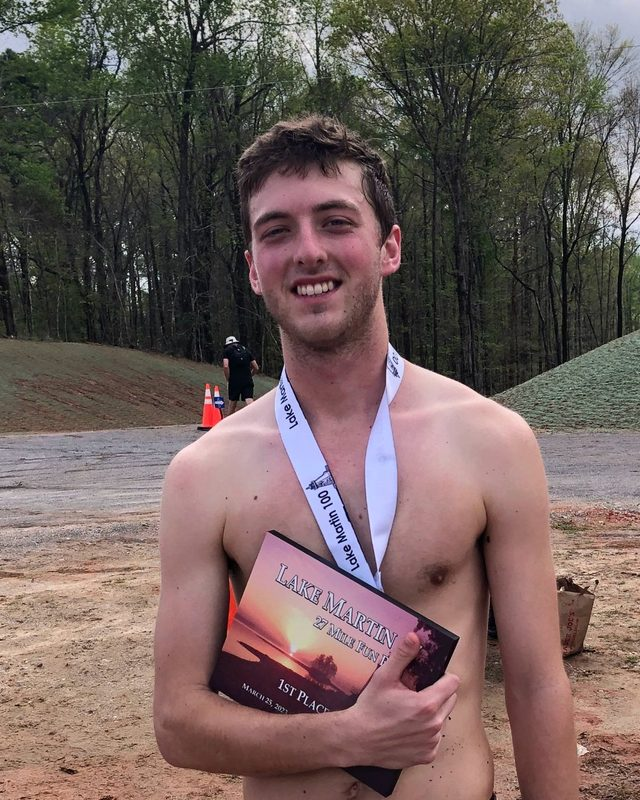
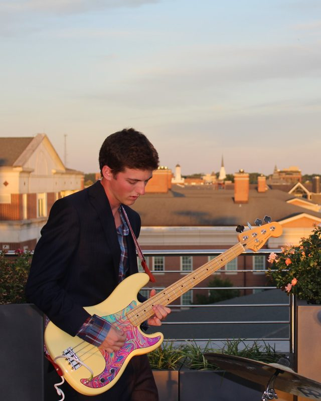
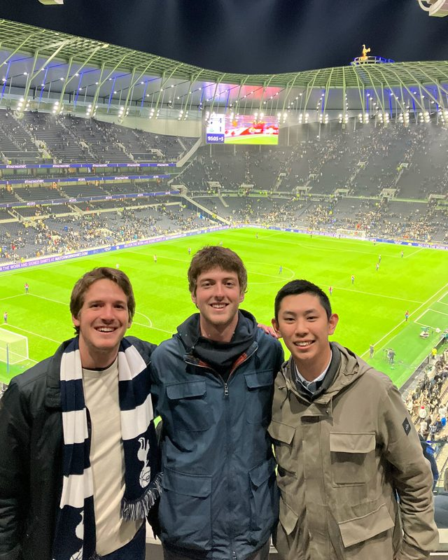

I'm a Research Associate at the <a href="https://www.bostonfed.org">Federal Reserve Bank of Boston</a>, where I work on household decision making, labor, and health economics. I'm applying to PhD programs in economics.

I took a slightly unusual route here. I started in medical physics with the <a href="https://bertoletlab.mgh.harvard.edu/">Bertolet Lab</a> at Massachusetts General Hospital, modeling radiation dose distributions in tumor treatment, before moving into economics, with an MSc thesis at the London School of Economics on the 1933 U.S. banking crisis. These days most of my research asks how recessions show up in people's lives: in births, in deaths, and in the welfare cost of the business cycle. You can find that work under [projects](/projects/).




<h2 class="jt-section-label">Recently read</h2>

  
<a href="{{ latest.link }}">{{ latest.title }}</a>

  
{{ latest.authors }} · {{ latest.read | append: '-01' | date: '%B %Y' }} · <a href="/reading/">full reading log →</a>



<h2 class="jt-section-label">Outside of econ</h2>

  <button type="button" class="jt-flip" aria-pressed="false" aria-label="Running: show photo">
    
      
        <i class="fa-solid fa-person-running jt-offhours-icon" aria-hidden="true"></i>
        Running
        Training to qualify for the Boston Marathon, chasing a BQ this spring.
        <i class="fa-solid fa-camera" aria-hidden="true"></i> see the photo
      
      
        
        Lake Martin Ultra – 27-mile winner
      
    
  </button>
  <button type="button" class="jt-flip" aria-pressed="false" aria-label="Making music: show photo">
    
      
        <i class="fa-solid fa-music jt-offhours-icon" aria-hidden="true"></i>
        Making music
        Writing and playing music.
        <i class="fa-solid fa-camera" aria-hidden="true"></i> see the photo
      
      
        
        Performing at a rooftop concert – Auburn, AL
      
    
  </button>
  <button type="button" class="jt-flip" aria-pressed="false" aria-label="Sports: show photo">
    
      
        <i class="fa-solid fa-football jt-offhours-icon" aria-hidden="true"></i>
        Sports
        A fan of everything from football to cycling.
        <i class="fa-solid fa-camera" aria-hidden="true"></i> see the photo
      
      
        
        Tottenham Hotspur Stadium
      
    
  </button>

<em>Views expressed here are my own and do not represent those of the Federal Reserve Bank of Boston or the Federal Reserve System.</em>

