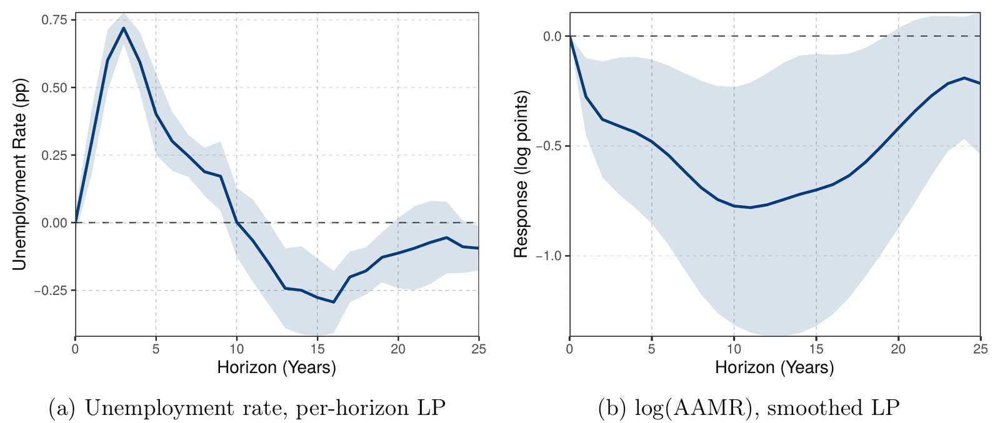

Recessions reduce mortality, but the evidence rests either on contemporaneous panel methods or on a single episode. This paper tests the external validity of Finkelstein et al. (2025), who document a persistent mortality decline after the Great Recession, by extending their design to all six major U.S. recessions since 1969.

Age-adjusted mortality falls by 0.53 log points per percentage-point state-level unemployment shock over the following decade, and excluding the Great Recession barely changes the estimate, suggesting the decline is a general feature of U.S. business cycles. Because the state panel spans nearly five decades, the response can be followed far past what any single recession allows: mortality remains depressed 25 years out, fifteen years after unemployment has recovered. In a standard welfare model, this persistence lowers the cost of business cycles by more than the contemporaneous response itself.

<figure class="jt-figure">
  
  <figcaption>Responses to a one-point state unemployment shock, six U.S. recessions, 1969–2016. Unemployment recovers within a decade (left); age-adjusted mortality stays below baseline for 25 years (right). Shaded bands are 95% confidence intervals.</figcaption>
</figure>

[PDF](/assets/pdf/main.pdf)
