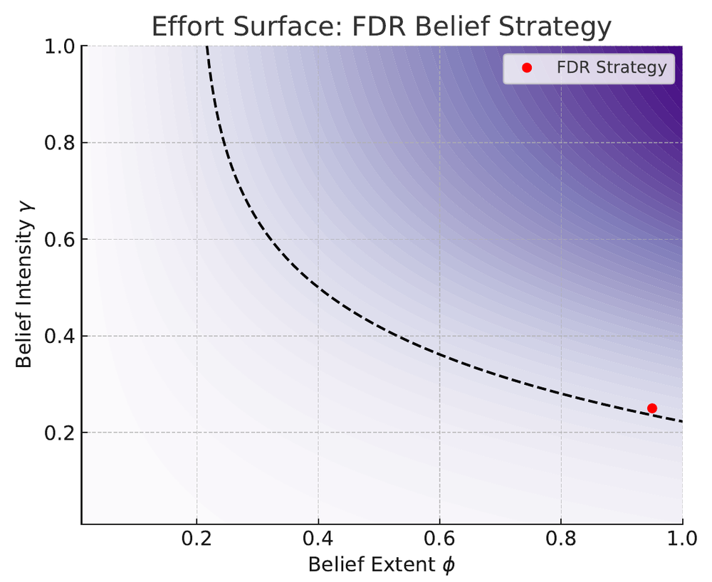

MSc Thesis, London School of Economics, 2025. This paper develops a theoretical framework of belief as a strategic coordination tool and tests it using evidence from the 1933 U.S. Banking Crisis.

<figure class="jt-figure jt-figure--narrow">
  
  <figcaption>Effort surface under belief parameters. The dashed line marks the effort threshold for coordination; FDR's strategy (red) relied on broad but shallow belief.</figcaption>
</figure>

[PDF](/assets/pdf/extended_essay.pdf)
